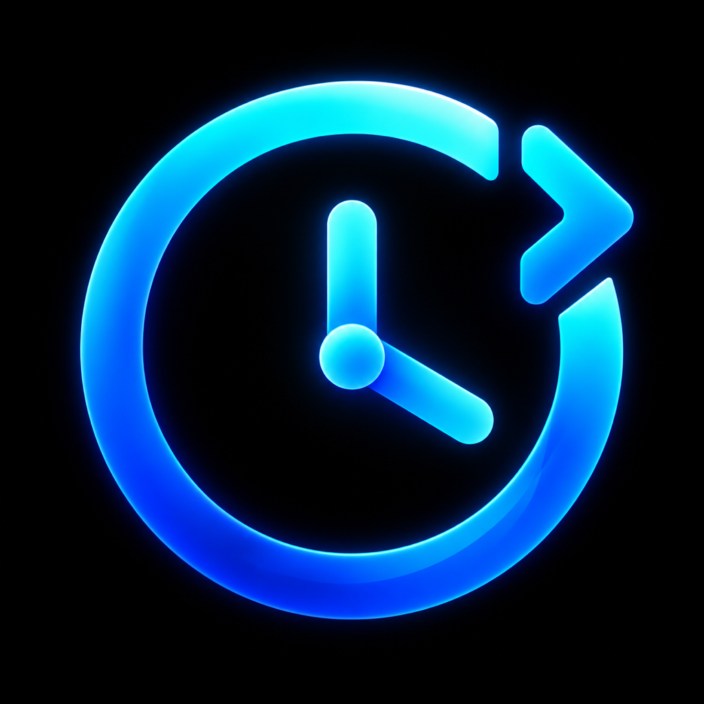

# NextClock

Custom lock screen clocks for rootless iOS 15, with an experimental iOS 16–17 beta.

## 1.2.0 beta 9

Adds experimental Always-On Display clock rendering, tested on iPhone 14 Pro with iOS 16.2. The main settings page now includes diagnostic export, SpringBoard restart, and reset.

## 1.2.0 beta 7

Choose a pack in Configure clock and apply it to the current Lock Screen. Use the global pack action to remove an assignment. The new controls support all nine languages. Wallpaper switching was tested on iPhone X with iOS 16.7.5.

## 1.2.0 beta 6

Charging visibility and wallpaper-editor rendering improvements. Developer-tested on iPhone X / iOS 16.7.5 and iPhone 7 Plus / iOS 15.8.8. Gallery thumbnails remain native; no per-wallpaper pack selection or new iOS 18 support. See [IOS16-REWORK.md](IOS16-REWORK.md).

Adds date font design, relative size and weight customization, favorite packs with opt-in double-tap switching, an animated draft preview with Apply, and a stable-release archive for rollback. Beta 2 consolidates appearance controls (including color and Low Power Mode) in Configure clock and moves maintenance tools to Advanced. Beta 3 uses native grouped editor lists, checkmark selection pages, Dynamic Type and VoiceOver labels, respects Reduce Motion, and confirms respring. Profile saving remains Pro-only. New gestures and preview behavior require device testing. See [BETA-1.2.md](BETA-1.2.md).

## Compatibility

The separate, unpublished [NextClock Pro prototype](PRO-ALPHA.md) adds an opt-in
preview and appearance-profile editor. Build it explicitly with `NC_PRO=1`;
the ordinary build retains the free feature set.

- Rootless iOS 15: previously tested devices listed below
- iOS 16–17: experimental; limited tester reports, not universal compatibility
- Includes arm64 and arm64e binaries for both the tweak and preferences bundle
- Requires PreferenceLoader

Confirmed working:
- iPhone 7 Plus — iOS 15.8.8, Dopamine
- iPhone 12 — iOS 15.3.1 (confirmed by a tester)
- iPhone 13 Pro Max — iOS 15.1.1, Dopamine (compatibility fix confirmed by a tester)

The optional seconds display has been tested on iPhone 7 Plus; it has not yet been separately verified on iPhone 12 or iPhone 13 Pro Max. Other devices and iOS 15 versions require testing.

## 1.1.0 — October 23, 2026

Includes the iOS 15 charging transition fixes, transparent animated Halloween pack, a greeting at the top of settings, and Italian/French localization. See [CHANGELOG.md](CHANGELOG.md) for details and remaining validation.

Tester videos confirm charging returns correctly with Anime and a visible date on iOS 15.8.8. RAtnik00 subsequently reported that the final RC1 device checks passed on the development iPhone 7 Plus. The iOS 16/17 adapter remains experimental; these iOS 15 charging changes do not establish modern-adapter compatibility.

Tester reports: iPhone X, iOS 16.1.2, Roothide 2.4.9.27 (adapter, seconds and date hiding); iPhone 14, iOS 16.6, nathanLR (beta 2 working). Earlier reports also describe custom packs on iPhone SE 2020 / iOS 17.0.2 and iPad 8 / iPadOS 17.4; exact build/jailbreak details are incomplete. These are limited reports, not universal compatibility claims.

Settings → NextClock → Export diagnostics shares a structural report (version, iOS, adapter/class availability and a bounded view snapshot). It excludes label text, notifications and device identifiers and is not uploaded automatically. Include model, exact iOS, jailbreak, package version and reproduction steps with a report. Keep stable 1.0.1 available for rollback.

## Features
PNG/GIF/APNG; static and animated modes; exact frame delays; shared animation timeline; speed; still images in Low Power Mode; tint preserving shading; 12/24/system time; optional seconds display; hide date; size, spacing, offset; live preferences; pack details, import, selection, deletion; reset and respring. Automatic English, Russian, Ukrainian, German, Polish, Swedish, Norwegian Bokmål, Italian and French preferences localization (English fallback). Clock and date yield to temporary system status text, including charging.

## Packs
A folder contains optional Info.plist and static/, animated/, or both. Each variant contains all 11 glyphs (0–9 and colon) as GIF or PNG. APNG uses .png. Metadata: Name, Version, Author, optional FormatVersion = 1. Existing .flexpack folders work. ZIP and .nextclock files are ordinary ZIP archives containing a pack directly or in one enclosing folder. Each import creates a separate copy and preserves existing packs.

Bundled packs: /var/jb/Library/Application Support/NextClock/Packs. Imported packs: /var/mobile/Library/NextClock/Packs. User packs survive upgrades.

Image limits: 2048 px per dimension, 240 frames, 8 MB encoded and 96 MB decoded per glyph. Rendering also limits decoded glyph frames to 48 MB per clock row; a row exceeding this budget falls back to the system clock. ZIP limits: 64 MB compressed/expanded, 512 entries. Stored and deflated ZIP entries supported; encryption, ZIP64 and symlinks rejected.

### Community themes

Thanks to [peto-bot](https://github.com/peto-bot) ([**@peza198** on X](https://x.com/peza198)) for creating and sharing these six NextClock packs.

- **Pink Panther** features an animated tail.
- **Tom & Jerry Mix** features Tom and Jerry.
- **Tom & Jerry Big** features larger characters, including Tweety.
- **Funny Numbers** has dancing legs and moving hands.
- **Christmas** is a static holiday pack.
- **Heavenly** animates some of its symbols.

[Download the original community archive](https://www.mediafire.com/file/jg4cj3tav878pgr/nextclock_themes.zip/file)

Unzip the outer archive. In **Settings → NextClock → Manage packs → Import pack**, choose the ZIP for the pack you want. Import each inner ZIP separately.

## Build
Theos, Xcode, patched iOS 16.5 SDK. Run the checks in [Tests/README.md](Tests/README.md), then `make package FINALPACKAGE=1`. arm64 and arm64e, rootless, deployment iOS 15. The rootless package architecture remains `iphoneos-arm64`. PreferenceLoader required.

## Acknowledgements
NextClock includes adaptations from [FlexClock](https://github.com/tr3tol/FlexClock) by [tr3tol](https://github.com/tr3tol), including its settings layout and pack conventions. Thank you to tr3tol for the original project. NextClock adds its own rendering, validation and compatibility work for earlier iOS versions. The original clock concept and Anime artwork are credited to [AniTime](https://github.com/yandevelop/AniTime) by yandevelop. See [CREDITS.md](CREDITS.md) for attribution and licensing details.

Anime artwork is from AniTime; Pixel, CRT and Sakura artwork is from the supplied FlexClock reference. These are third-party assets, not original NextClock artwork. Artwork rights are separate from the source-code license; see [CREDITS.md](CREDITS.md). AniTime source code is not included.

## Adaptations
Staged imports and confirmations preserve existing packs; every glyph is validated; reset clears all implemented preferences. iOS 15 clocks are bounded to screen width. Exact frame delays improve on uniform reference playback. About names NextClock and RAtnik00; acknowledgements are in this README.

## Device verification
Local release checks passed on the development device, alongside native pack/ZIP and resource tests. Other devices still need validation, especially iOS 16/17 wallpaper, music and charging transitions. Report model, exact iOS, jailbreak and installed version with any issue.

## Roadmap
An iOS 13–14 port is planned as a separate update. Version 1.1.0 requires iOS 15 or newer; it does not include that port.

## License
NextClock source is provided under GPL-3.0. The settings layout is adapted from [FlexClock](https://github.com/tr3tol/FlexClock) by tr3tol (GPL-3.0); attribution is retained in [CREDITS.md](CREDITS.md). Halloween artwork was generated with the built-in image generation tool and animated with the accompanying pack builder. This source license does not grant rights to third-party artwork.

## Support
NextClock is free. Optional support: [buycoffee.to/ratnik00](https://buycoffee.to/ratnik00). Supporting the developer does not unlock extra features.

## Experimental iOS 12–14 port

An opt-in **rootful** test build is being prepared separately from the iOS 15+
release. See [LEGACY-TESTING.md](LEGACY-TESTING.md) for package selection, the
iOS 12/13 arm64e limitation, build commands and the device-testing checklist.
This port has not yet been verified on a physical device.
